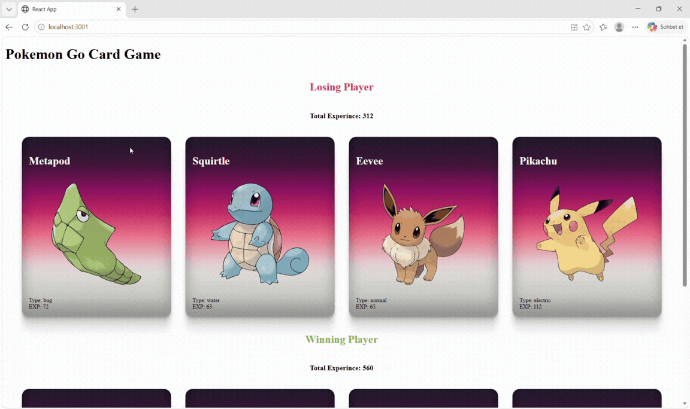

# Pokemon Go Card Game – React Pokemon Card Battle App

An interactive and responsive **Pokemon Card Game** developed with React. The application randomly distributes Pokémon from an existing list into two teams, compares their total experience points, and determines the winning team. Pokemon images are fetched from the PokeAPI.

## 📌 Project Overview

This project was developed to practice React's component-based architecture, props, state management, and dynamic list rendering.

When the application starts, two random teams are generated from the existing Pokémon list. Each team's total experience points are calculated, and the results are displayed as **Winning Player** and **Losing Player**.

## 🛠 Technologies Used

- React.js
- JavaScript (ES6)
- CSS3
- Class Components
- Props & DefaultProps
- PokeAPI
- Array Methods (`map`, `reduce`, `splice`)

## 👀 Preview

